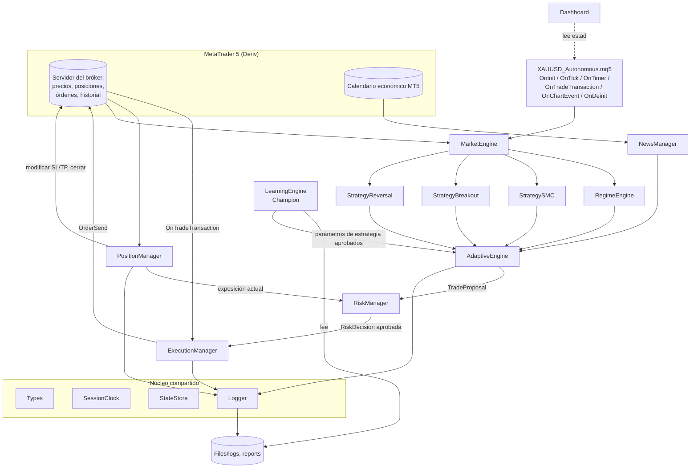
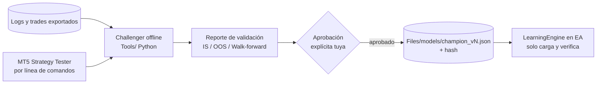
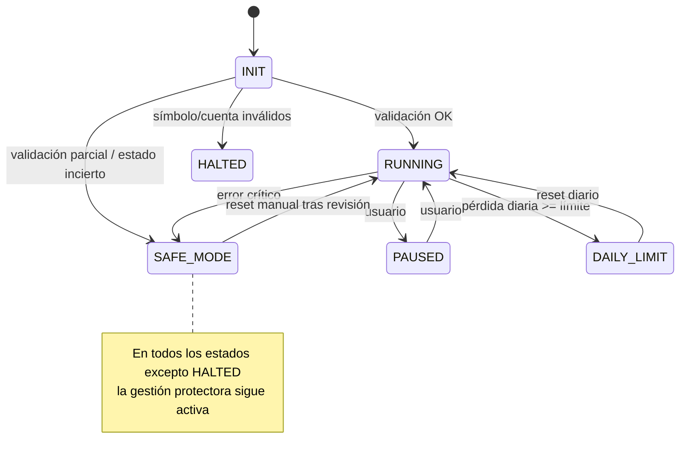

# Arquitectura técnica — XAUUSD Autonomous Trading System

> Estado: **FASE 1 — Diseño y diagnóstico**. Ningún módulo MQL5 está implementado todavía.
> Este documento es la especificación contra la que se construirán y revisarán las fases 2–13.

---

## 1. Diagnóstico del entorno (2026-10-12)

| Elemento | Resultado | Consecuencia |
|---|---|---|
| Repositorio | Vacío (sin commits previos) | No hay código existente que preservar. |
| Sistema operativo del entorno de desarrollo | Linux (contenedor en la nube) | MetaTrader 5 / MetaEditor son aplicaciones Windows. |
| MetaTrader 5 / MetaEditor | No venían instalados. **Actualización Fase 2:** instalados bajo Wine 9.0 (MT5 build 6257) con `Tools/setup_wine_mt5.sh` | **Se puede compilar y ejecutar scripts de prueba aquí** (`Tools/compile.sh`, `Tools/run_tests.sh`). El terminal no se conecta a ninguna cuenta. |
| Wine | Instalado en Fase 2 (Wine 9.0) | MT5 avisa que Wine 9.0 no está soportado oficialmente (recomienda >= 10). Compilación y pruebas funcionaron; la referencia final sigue siendo tu MetaEditor en Windows. |
| Python | 3.13 disponible | Útil para análisis offline (LearningEngine/Challenger, reportes). El paquete `MetaTrader5` de Python solo funciona en Windows, según mi conocimiento — verificar. |
| Red saliente | Disponible | Permitió descargar el instalador oficial de MT5. |
| Cuenta Deriv | No accesible desde aquí | Las especificaciones reales de XAUUSD deben leerse en tu terminal con `SymbolSpecDump` (ver §9). |

**Conclusión:** el código se compila y se prueba aquí con datos sintéticos (símbolos personalizados). Las pruebas con datos reales de Deriv (historial, spread, calendario) solo pueden hacerse en tu terminal.

---

## 2. Principios de diseño

1. **Fallar de forma segura**: ante cualquier duda (datos inválidos, error del servidor, estado incierto) se bloquean *nuevas entradas*; la gestión protectora de posiciones abiertas (SL/BE/trailing) **nunca** se desactiva.
2. **Responsabilidad única**: solo `ExecutionManager` envía órdenes de apertura; solo `PositionManager` modifica/cierra posiciones; solo `RiskManager` calcula volumen y aprueba riesgo.
3. **El servidor es la fuente de verdad**: el estado interno se reconstruye desde posiciones, órdenes e historial del servidor; los ficheros persistentes solo complementan (metadatos de señales, snapshot diario).
4. **Velas cerradas**: todas las decisiones de entrada se toman sobre la última vela **cerrada** (shift ≥ 1). La vela en formación solo se usa para precio actual/spread.
5. **Sin repintado**: un swing/pivote solo existe cuando han cerrado las N velas que lo confirman.
6. **Explicabilidad**: cada señal lleva `signal_id`, motivo y evidencia; cada descarte lleva motivo.
7. **El aprendizaje nunca toca el riesgo** ni el modelo activo sin aprobación explícita.
8. **Trading real deshabilitado por defecto** (ver §8.3).

---

## 3. Estructura del proyecto

```
XAUUSD_AUTONOMOUS/
├── Experts/XAUUSD_Autonomous.mq5      # Orquestador: eventos, ciclo, wiring
├── Include/XAUUSD/
│   ├── Types.mqh            (*) enums, structs y constantes compartidas
│   ├── SessionClock.mqh     (*) conversión de zonas horarias y sesiones
│   ├── StateStore.mqh       (*) persistencia atómica de estado
│   ├── MarketEngine.mqh
│   ├── RegimeEngine.mqh
│   ├── PatternLib.mqh       (*) detección de patrones compartida (Fase 4)
│   ├── StrategyBase.mqh     (*) base de estrategias: SL/TP, confirmación M5, invariantes (Fase 4)
│   ├── StrategySMC.mqh
│   ├── StrategyBreakout.mqh
│   ├── StrategyReversal.mqh
│   ├── AdaptiveEngine.mqh
│   ├── RiskManager.mqh
│   ├── TradeGateway.mqh     (*) única puerta al servidor (real o simulada en pruebas) (Fase 7)
│   ├── ExecutionManager.mqh
│   ├── NewsManager.mqh
│   ├── PositionManager.mqh
│   ├── LearningEngine.mqh
│   ├── Dashboard.mqh        (*) panel en el gráfico
│   └── Logger.mqh
├── Files/{history,models,reports,logs}   # datos generados (no versionados salvo .gitkeep)
├── Tests/{Backtesting,Validation,StressTests}
├── Tools/                   (*) scripts Python offline (Challenger, reportes)
└── Documentation/
```

`PatternLib` y `StrategyBase` se añadieron en la Fase 4 para cumplir "no duplicar lógica entre módulos": barridos, rupturas, FVG y construcción de SL/TP los usan varias estrategias.

`(*)` = **módulos adicionales propuestos** que no estaban en la lista original. Justificación:
- `Types.mqh`: evita dependencias circulares y duplicación de structs entre módulos.
- `SessionClock.mqh`: la conversión horaria la necesitan MarketEngine, NewsManager, RiskManager (reset diario) y Dashboard; ponerla en uno solo violaría "no duplicar lógica".
- `StateStore.mqh`: la persistencia la necesitan Risk, Position, Execution y Learning.
- `Dashboard.mqh`: la UI no debe vivir en el `.mq5` ni mezclarse con lógica de trading.

**Requieren tu aprobación** (decisión D1 en §12).

---

## 4. Diagrama de componentes



**Fuera del EA (offline):** el *Challenger* corre como proceso separado (Python + Strategy Tester por línea de comandos). Nunca está cargado en el EA en producción.



---

## 5. Flujo de eventos y señales

### 5.1 Ciclo por evento

| Evento | Frecuencia | Responsabilidad |
|---|---|---|
| `OnInit` | Una vez | Validar entorno, inputs, símbolo, cuenta; crear handles; reconstruir estado (§7). Si algo crítico falla → `INIT_FAILED` o arrancar en `SAFE_MODE`. |
| `OnTick` | Cada tick | (1) `PositionManager.ManageProtective()` siempre (con throttle configurable). (2) Detectar **nueva vela M5 cerrada** → ejecutar pipeline de análisis. |
| `OnTimer` (1 s) | Periódico | Reconciliación con servidor, refresco de noticias, reset diario, heartbeat de conexión, actualización del dashboard. |
| `OnTradeTransaction` | Por transacción | Confirmar/rechazar solicitudes pendientes; registrar deals (comisión, swap, slippage); actualizar mapping ticket↔signal_id. |
| `OnChartEvent` | Interacción | Botones del dashboard (pausa, modo seguro, cierre con doble confirmación). |
| `OnDeinit` | Una vez | Persistir estado, liberar handles, cerrar logs. **No cierra posiciones.** |

### 5.2 Pipeline de análisis (nueva vela M5 cerrada)

```mermaid
sequenceDiagram
    participant EA
    participant ME as MarketEngine
    participant RE as RegimeEngine
    participant S as Estrategias (SMC/BO/RV)
    participant NM as NewsManager
    participant AE as AdaptiveEngine
    participant RM as RiskManager
    participant EX as ExecutionManager

    EA->>ME: Update()  (H1, M15, M5 cerrados)
    ME-->>EA: MarketSnapshot (valid? motivo)
    alt snapshot inválido
        EA->>EA: Gate DATA bloquea entradas, log motivo
    end
    EA->>RE: Classify(snapshot)
    RE-->>EA: RegimeState
    EA->>EA: Evaluar gates (estado, sesión, noticias, límite diario, spread)
    alt algún gate cerrado
        EA->>EA: log "entrada bloqueada: motivo"; fin
    end
    EA->>S: Evaluate(snapshot, regime) x3
    S-->>AE: TradeSignal[] (0..n)
    AE->>AE: Puntuar, detectar conflictos, deduplicar
    AE-->>EA: TradeProposal (o descarte con motivo)
    EA->>RM: Assess(proposal, exposición actual)
    RM-->>EA: RiskDecision (volumen, riesgo $, aprobado/rechazado+motivo)
    EA->>EX: Execute(decision)
    EX->>EX: Validaciones pre-envío, OrderCheck, OrderSend
    EX-->>EA: ExecutionResult (DONE / REJECTED / UNCERTAIN)
```

### 5.3 Gates de entrada (todos deben estar abiertos)

| Gate | Cerrado cuando |
|---|---|
| `STATE` | Estado del EA ≠ `RUNNING` (pausado, modo seguro, halted). |
| `ACCOUNT` | Cuenta real sin autorización explícita; trading algorítmico deshabilitado en terminal/EA/cuenta. |
| `DATA` | Datos insuficientes, desactualizados o inválidos en cualquier TF. |
| `CONNECTION` | `TERMINAL_CONNECTED` falso o último tick más viejo que el umbral. |
| `SESSION` | Fuera de Londres/NY (convertido a hora servidor), o mercado cerrado según `SymbolInfoSessionTrade`. |
| `NEWS` | Ventana de bloqueo activa o fuente de noticias no verificable (política conservadora). |
| `DAILY_LIMIT` | Pérdida diaria ≥ límite. |
| `SPREAD` | Spread > máximo absoluto o > k × spread medio. |
| `REGIME` | Régimen = `NO_TRADE`. |
| `PENDING` | Existe una solicitud de ejecución en estado incierto sin reconciliar. |

Cada gate cerrado se registra **una vez por cambio de estado** (no en cada tick) para no saturar los logs.

---

## 6. Interfaces entre módulos

> Notación de especificación. Los nombres de funciones de la API de MQL5 citados aquí son los que conozco de la documentación oficial; **cada uso se verificará contra la documentación actual al implementar**. Los nombres de clases/métodos propios del proyecto son nuestros y pueden ajustarse.

### 6.1 Tipos compartidos (`Types.mqh`)

```text
enum EAState        { EA_INIT, EA_RUNNING, EA_PAUSED, EA_SAFE_MODE, EA_DAILY_LIMIT, EA_HALTED }
enum Regime         { REGIME_TREND_UP, REGIME_TREND_DOWN, REGIME_RANGE, REGIME_HIGH_VOLATILITY, REGIME_NO_TRADE }
enum Direction      { DIR_NONE, DIR_LONG, DIR_SHORT }
enum StrategyId     { STRAT_SMC, STRAT_BREAKOUT, STRAT_REVERSAL }
enum ExecStatus     { EXEC_DONE, EXEC_REJECTED, EXEC_UNCERTAIN, EXEC_SKIPPED }
enum SessionId      { SESSION_NONE, SESSION_LONDON, SESSION_NEWYORK, SESSION_OVERLAP }

struct SwingPoint   { datetime time; double price; bool is_high; int bar_index; ENUM_TIMEFRAMES tf; }

struct TFData {                       // por temporalidad
  ENUM_TIMEFRAMES tf;
  bool     valid;  string invalid_reason;
  datetime last_closed_bar_time;
  MqlRates rates[];                   // velas cerradas, serie
  double   ema50, ema200, rsi, adx, plus_di, minus_di, atr;   // en shift 1
  SwingPoint swings[];                // confirmados
  double   momentum;                  // definición en STRATEGIES.md
}

struct MarketSnapshot {
  bool   valid; string invalid_reason;
  datetime server_time; SessionId session;
  double bid, ask, spread_points, spread_avg_points;
  TFData h1, m15, m5;
}

struct RegimeState  { Regime regime; double adx_h1, atr_ratio; string reason; }

struct TradeSignal {
  string     signal_id;              // único: STRAT-TF-timestamp-hash
  StrategyId strategy;  Direction direction;
  ENUM_TIMEFRAMES origin_tf;
  double entry_low, entry_high;      // zona de entrada
  double invalidation;               // nivel estructural
  double sl_suggested, tp_suggested;
  datetime created, expires;
  string reason;                     // texto corto
  string evidence;                   // clave=valor; p.ej. "sweep=2318.4;bos=2322.1;fvg=2320.0-2320.9"
  double component_scores[6];        // H1, M15, liquidez, M5, momentum/vol, ejecución
}

struct TradeProposal { TradeSignal signal; double score; string score_breakdown; string conflicts; }

struct RiskDecision {
  bool   approved; string reject_reason;
  double volume, risk_money, risk_pct, rr, margin_required;
  double exposure_before_pct, exposure_after_pct;
  double sl, tp;
}

struct ExecutionResult {
  ExecStatus status; uint retcode; string retcode_desc;
  ulong order_ticket, deal_ticket, position_id;
  double requested_price, fill_price, slippage_points;
}

struct PositionRecord {               // reconstruible desde servidor + StateStore
  ulong ticket; ulong position_id; string signal_id; StrategyId strategy;
  Direction direction; double volume, open_price, initial_sl, current_sl, tp, initial_risk_money;
  bool be_done; bool trailing_active; double invalidation;
}
```

### 6.2 Contratos por módulo

| Módulo | Entradas | Salidas | Prohibido |
|---|---|---|---|
| **MarketEngine** | símbolo, TFs, parámetros indicadores | `MarketSnapshot` | Enviar órdenes; decidir entradas. |
| **RegimeEngine** | `MarketSnapshot` | `RegimeState` | Leer datos directamente del servidor (usa el snapshot). |
| **StrategySMC / Breakout / Reversal** | `MarketSnapshot`, `RegimeState` | `TradeSignal[]` | Calcular volumen; conocer cuenta; enviar órdenes. |
| **AdaptiveEngine** | señales, régimen, `NewsState`, parámetros Champion, posiciones abiertas (solo lectura) | `TradeProposal` o descarte + motivo | Saltarse RiskManager; modificar riesgo. |
| **RiskManager** | `TradeProposal`, especificación de símbolo, cuenta, exposición actual (desde PositionManager) | `RiskDecision` | Enviar órdenes; ser modificado por Learning. |
| **ExecutionManager** | `RiskDecision` aprobada | `ExecutionResult` | Recalcular volumen; reintentar con estado incierto. |
| **PositionManager** | posiciones del servidor, `PositionRecord` persistidos, snapshot | modificaciones SL/TP, cierres por invalidación, exposición actual | Abrir posiciones; ampliar SL. |
| **NewsManager** | calendario MT5 / fichero histórico / proveedor externo | `NewsState {blocked, reason, next_event, source_ok}` | Inventar eventos; usar datos sin marcar su fecha de actualización. |
| **LearningEngine (EA)** | estadísticas de trades, `champion_vN.json` | métricas, parámetros de estrategia aprobados | Tocar parámetros de riesgo; cargar modelo sin aprobación/hash válido. |
| **Logger** | eventos estructurados | CSV/JSONL en `Files/logs` | Lanzar excepciones que detengan el EA. |
| **StateStore** | estado serializable | fichero atómico (escribir tmp → renombrar) | Ser fuente de verdad sobre posiciones (lo es el servidor). |
| **SessionClock** | hora servidor, offset, reglas DST | sesión activa, conversión UTC↔servidor | Asumir zona horaria de Colombia. |
| **Dashboard** | estado de solo lectura | comandos al EA (pausa, safe mode, cierre confirmado) | Ejecutar trading directamente (pasa por EA/PositionManager). |

---

## 7. Persistencia, reinicio y reconciliación

**Fuente de verdad:** servidor (`PositionsTotal`/`PositionGetTicket`, `OrdersTotal`, `HistorySelect` + deals).
**Complemento persistente (`StateStore`, carpeta común de terminal):**
- `state.json`: estado del EA, snapshot de equity al inicio del día y fecha del reset, solicitudes pendientes (`request_uid`, hora, parámetros).
- `positions_meta.json`: `position_id → {signal_id, strategy, initial_sl, initial_risk_money, invalidation, be_done}`.

**Identificación de operaciones propias:** `magic number` (input) + `comment` con `signal_id` corto. El comentario **puede ser truncado o reemplazado por el bróker** — por eso el mapping persistente es por `position_id`, y el comentario es solo respaldo.

**Algoritmo de arranque:**
1. Leer `state.json` (si corrupto → `SAFE_MODE`, registrar).
2. Enumerar posiciones con nuestro magic y símbolo; cruzar con `positions_meta.json`.
3. Posición sin metadatos → adoptar con `initial_sl = SL actual` (conservador) y marcarla "huérfana" en log.
4. Posición **sin SL** → `SAFE_MODE` + intento de poner SL protector basado en ATR/estructura (regla configurable) + alerta.
5. Solicitud pendiente en `state.json` → buscar en historial de órdenes/deals por comentario/magic/hora; resolver como ejecutada o no ejecutada. Si no se puede resolver → mantener `PENDING` gate cerrado y alertar.
6. Recalcular exposición y pérdida diaria desde el servidor.

**Anti-duplicado de órdenes:**
- Un `signal_id` solo puede generar **una** solicitud; se marca como consumido antes del `OrderSend`.
- Si `OrderSend` devuelve un retcode ambiguo (p. ej. timeout, sin respuesta, conexión perdida) → estado `EXEC_UNCERTAIN`, **no reintentar**; reconciliar en el siguiente `OnTimer`.
- Reintentos solo para retcodes explícitamente no ejecutados (p. ej. requote/precio cambiado), máximo N (input, por defecto 2), recalculando precio y re-validando riesgo/spread.

---

### 7.1 Implementación (Fase 7)
- `TradeGateway.mqh`: interfaz con `CTerminalGateway` (OrderCheck/OrderSend, posiciones, órdenes, historial) — ExecutionManager y PositionManager no llaman a la API de trading directamente, lo que permite probarlos con un servidor simulado.
- Clasificación de retcodes: DONE/DONE_PARTIAL/PLACED = éxito; REQUOTE/PRICE_CHANGED/PRICE_OFF = reintentable (máx. 2); TIMEOUT/CONNECTION/ERROR/sin código = **incierto (no se reintenta)**; el resto = rechazo.
- La solicitud se registra como pendiente **antes** de `OrderSend`; mientras esté pendiente no se envía otra. Reconciliación: posición con el comentario → posición con misma dirección/volumen abierta tras el envío (si el bróker cambió el comentario) → deal de entrada en el historial → orden aún en proceso → sin rastro tras 90 s = no ejecutada.
- Comentario de orden: `XA|<hash de 8 hex>` (corto para tolerar truncado).

## 8. Seguridad operativa

### 8.1 Máquina de estados



`SAFE_MODE` **no sale automáticamente**: requiere acción del usuario (botón con confirmación) para evitar oscilaciones.

### 8.2 Errores críticos (→ SAFE_MODE)
Posición propia sin SL; fallo al modificar SL repetido; estado de ejecución incierto no resoluble; cambio de símbolo/especificación (tick value, contract size, volume step) durante la ejecución; fichero de estado corrupto; margen libre bajo umbral; N errores de servidor consecutivos.

### 8.3 Protección contra trading real
- Input `InpAllowRealAccount = false`.
- Si `AccountInfoInteger(ACCOUNT_TRADE_MODE) != ACCOUNT_TRADE_MODE_DEMO` y no está autorizado → gate `ACCOUNT` cerrado permanentemente, mensaje claro en dashboard.
- Aun autorizado, se exige confirmar en un segundo input (`InpRealAccountConfirmation = "I UNDERSTAND THE RISK"`) para evitar activación accidental.

---

## 9. Especificaciones de XAUUSD en Deriv — a verificar en tu terminal

No tengo datos verificados de las especificaciones actuales de Deriv. **No las asumo.** El EA las leerá en `OnInit` y las registrará; además, en Fase 2 entregaré un script `Tests/Validation/SymbolSpecDump.mq5` que exporta:

| Dato | Propiedad MQL5 | Por qué importa |
|---|---|---|
| Nombre exacto del símbolo | `_Symbol` / `SymbolSelect` | Puede tener sufijo según el tipo de cuenta. |
| Dígitos, point | `SYMBOL_DIGITS`, `SYMBOL_POINT` | Conversión de distancias. |
| Tamaño de contrato | `SYMBOL_TRADE_CONTRACT_SIZE` | Un lote no vale lo mismo en todos los brókeres. |
| Tick size / tick value | `SYMBOL_TRADE_TICK_SIZE`, `SYMBOL_TRADE_TICK_VALUE(_LOSS)` | Cálculo de riesgo. |
| Volumen min/max/step | `SYMBOL_VOLUME_MIN/MAX/STEP` | Redondeo de lote. |
| Stops level / freeze level | `SYMBOL_TRADE_STOPS_LEVEL`, `SYMBOL_TRADE_FREEZE_LEVEL` | Validación SL/TP y modificaciones. |
| Modo de ejecución y filling | `SYMBOL_TRADE_EXEMODE`, `SYMBOL_FILLING_MODE` | Tipo de filling en `OrderSend`. |
| Spread flotante/fijo | `SYMBOL_SPREAD_FLOAT`, `SYMBOL_SPREAD` | Filtros de spread. |
| Sesiones de trading | `SymbolInfoSessionTrade` | Pausas diarias del oro. |
| Modo de margen de la cuenta | `ACCOUNT_MARGIN_MODE` | Hedging vs Netting. |
| Moneda de la cuenta | `ACCOUNT_CURRENCY` | Riesgo en divisa de cuenta. |
| Offset horario del servidor | `TimeTradeServer() - TimeGMT()` | Sesiones y noticias. |
| Comisión | No hay propiedad directa fiable en el símbolo; se mide desde los deals (`DEAL_COMMISSION`) | Costos reales. |

---

## 10. Conversión horaria y sesiones (`SessionClock`)

- **Hora del servidor** ≠ hora de Colombia (UTC−5 fijo). Nunca se asume.
- **En vivo:** `offset_servidor = TimeTradeServer() − TimeGMT()`, redondeado a 30 min y recalculado periódicamente (cambia con el horario de verano del servidor, si lo tiene).
- **En Strategy Tester:** según mi conocimiento, `TimeGMT()` en el tester devuelve la hora del servidor simulada, por lo que **el offset no se puede medir** → se usa un input `InpTesterServerGMTOffset` + regla DST configurable. *Verificar en documentación actual al implementar.*
- **Sesiones definidas en hora local de su plaza** (configurables) y convertidas con reglas DST:
  - Londres: 08:00–16:30 Europe/London (DST UE/UK: último domingo de marzo → último domingo de octubre, 01:00 UTC).
  - Nueva York: 08:00–17:00 America/New_York (DST EE. UU.: segundo domingo de marzo → primer domingo de noviembre, 02:00 local).
  - Las reglas DST vigentes deben verificarse; si cambian por ley, son configurables.
- Dashboard muestra hora servidor, UTC y Colombia.

---

## 11. Limitaciones de MQL5 / MetaTrader 5 relevantes

> Basadas en mi conocimiento de la documentación oficial de MQL5; marcadas "verificar" cuando no tengo total certeza.

1. **Calendario económico no disponible en Strategy Tester** (las funciones `Calendar*` no funcionan en pruebas, según la documentación que conozco — verificar). → Para backtest: un script exporta el historial del calendario en vivo a CSV y el EA lo lee en el tester (`#property tester_file` o carpeta común).
2. **`WebRequest` no funciona en el Strategy Tester** y requiere que el usuario agregue la URL en *Herramientas → Opciones → Asesores Expertos*. Las APIs de noticias externas y el dashboard web no se pueden probar en backtest.
3. **Volumen**: en CFD de oro normalmente solo hay *tick volume* (no volumen real). Los filtros "con volumen" usarán tick volume y se documentarán como proxy imperfecto.
4. **Un EA no puede lanzar el Strategy Tester** desde su propio código. → Challenger y walk-forward rodante se orquestan **fuera** (terminal por línea de comandos con fichero `.ini` + Python). El tester sí tiene optimización con período *forward* incorporado.
5. **No hay framework de unit tests oficial**. → Pruebas como *Scripts* MQL5 con aserciones propias, más el tester. La lógica pura (redondeo de lote, DST, detección de FVG sobre arrays) se diseñará sin dependencias del terminal para poder probarla con datos sintéticos.
6. **Netting**: una sola posición por símbolo; una nueva orden en la misma dirección **promedia** el precio y comparte SL/TP. Esto choca con "no promediar" y "máx. 3 posiciones". → En Netting: **máximo 1 posición en XAUUSD y prohibido añadir**.
7. **Comentarios de órdenes** pueden ser truncados/modificados por el servidor → no confiar en ellos como identificador principal.
8. **`OrderSend` síncrono** puede devolver resultado sin que el estado final esté reflejado aún en `PositionsTotal`; la confirmación definitiva llega por `OnTradeTransaction`. Hay que manejar ese intervalo (gate `PENDING`).
9. **Ficheros**: sandbox en `MQL5/Files` (o carpeta común con `FILE_COMMON`). Los agentes del tester tienen su propio sandbox.
10. **Sin hilos**: todo corre en un único hilo de eventos; cálculos pesados (SMC sobre muchas velas) deben ser incrementales para no bloquear `OnTick`.
11. **ONNX**: MQL5 soporta modelos ONNX (según mi conocimiento, desde builds de 2023 — verificar). Posible vía futura para un modelo del Challenger, siempre como filtro de estrategia, nunca de riesgo.
12. **`TimeCurrent()` no es "ahora"**: devuelve la hora del último tick conocido (en fin de semana o sin conexión puede ser de días antes; en la Fase 2 se observó 2024-08-23 con el terminal desconectado). Para la hora actual del servidor se usa `TimeTradeServer()`.
13. **El Strategy Tester exige una cuenta**: aunque el símbolo sea personalizado, el tester no arranca si el terminal no tiene una cuenta configurada (observado en Fase 3). Las pruebas en tester se ejecutan en tu terminal.
14. **Símbolos personalizados (solo pruebas)**: `CustomTicksAdd` reescribe la vela que contiene el tick como vela plana. Las pruebas que comparan series lo evitan.
15. **Datos históricos**: la calidad del backtest depende de los ticks del bróker. "Every tick based on real ticks" requiere que Deriv provea historial de ticks suficiente — verificar disponibilidad y antigüedad.

---

## 12. Riesgos técnicos a resolver antes de programar

| # | Riesgo | Impacto | Propuesta |
|---|---|---|---|
| R1 | No hay MetaEditor en este entorno | Código no compilado entregado como "listo" | Intentar Wine + MetaEditor en Fase 2; si no funciona, ciclo: yo escribo → tú compilas → me pegas errores. Nunca declararé compilado sin evidencia. |
| R2 | Especificaciones Deriv desconocidas | Volumen o costos mal calculados | Script de volcado de especificaciones (primer entregable de Fase 2). |
| R3 | Offset horario en tester | Sesiones/noticias desplazadas en backtest | Input de offset + DST para tester; verificación cruzada con la pausa diaria del oro en los datos. |
| R4 | Noticias en backtest | Backtest más optimista que la realidad | Exportar historial de calendario a CSV; marcar backtests sin noticias como "no válidos para aprobación". |
| R5 | Puntuación sesgada contra Reversal | La estrategia Reversal (contra tendencia H1) obtendría 0/20 en "Tendencia H1" y casi nunca superaría 65 | Definir el componente "Tendencia H1" **por estrategia**: para Reversal mide agotamiento/contexto en H1, no alineación. Ver STRATEGIES.md. |
| R6 | 1 % por operación con 2 % de exposición máxima | La 3.ª posición solo es posible si alguna está en break-even | Es coherente, pero debe quedar explícito (ver RISK_MANAGEMENT.md). |
| R7 | Netting vs Hedging | Promedio involuntario de posiciones | Netting = 1 posición máx., sin añadir. |
| R8 | Repintado de swings/SMC | Backtest irreal | Solo pivotes confirmados; tests que comparan señales en tiempo real vs recalculadas. |
| R9 | Sobreajuste del sistema de puntuación | Umbrales 65/80 sin base estadística | Tratarlos como hipótesis iniciales; calibración solo con OOS + walk-forward. |
| R10 | Pérdida diaria con flotante | Reset en mitad de posiciones abiertas | Base = equity al reset diario (ver RISK_MANAGEMENT.md §4). |
| R11 | Fuente de noticias no verificable en vivo | Bloqueo indefinido o trading a ciegas | Política conservadora configurable (decisión D3). |
| R12 | Gaps del fin de semana / pausa diaria | SL saltado, slippage | No abrir N minutos antes de cierre de sesión/viernes; registrar slippage real. |

## 13. NewsManager — diseño

| Fuente | Uso | Disponible en tester |
|---|---|---|
| Calendario MT5 (`CalendarValueHistory`, `CalendarEventById`, filtrado por moneda USD e importancia alta) | Fuente principal en vivo | No (según documentación — verificar) |
| CSV histórico exportado por script desde el calendario en vivo | Backtest | Sí |
| Proveedor externo vía `WebRequest` | Opcional, interfaz `INewsProvider` | No |

- Clasificación por palabras clave/IDs de evento (NFP, CPI, PCE, FOMC, tasas, discursos Fed) → ventana: 30 min antes/después; otros USD alta importancia: 20 min.
- **Frescura**: se registra la hora de la última actualización exitosa; si supera el umbral → `source_ok = false` → política conservadora (decisión D3).
- Los eventos con hora "todo el día"/sin hora exacta se tratan con ventana ampliada configurable.
- No se inventan eventos; un CSV con fecha de exportación anterior al período probado se rechaza.

**Implementado (Fase 8):** `NewsManager.mqh`. Horas en hora del servidor de punta a punta (calendario MT5 y CSV del tester usan la zona del bróker; que el calendario entregue hora del servidor es según mi conocimiento de la documentación — verificar con `ExportCalendar` y un evento conocido). Clasificación por nombre: NFP, CPI, PCE, FOMC, tasas, Fed/Powell = mayor (30/30 min); empleo con importancia ≥ moderada y cualquier USD de alta importancia = USD (20/20 min). Política D3: fuente con error, vacía, con más de 60 min sin recarga correcta, o instante fuera de la cobertura → bloqueo de todas las entradas nuevas. Exportador: `Tests/Backtesting/ExportCalendar.mq5`.

## 14. LearningEngine — Champion vs Challenger

- **Champion (dentro del EA):** solo **lee** `Files/models/champion_vN.json` (parámetros de estrategia y umbrales de puntuación) y verifica: hash SHA-256 (`CryptEncode` con `CRYPT_HASH_SHA256` — verificar) contra `champion_vN.sha256`, campo `approved_by`/`approved_at`, y que **no contenga claves de riesgo** (lista negra explícita). Si falla → usa los parámetros por defecto compilados y lo registra.
- **Estadísticas en vivo:** el EA calcula y exporta métricas por estrategia/sesión/régimen/día (lo que el EA ve directamente), sin cambiar nada.
- **Challenger (fuera del EA, `Tools/`):** Python lee los logs/CSVs, lanza el Strategy Tester por línea de comandos con configuraciones candidatas, ejecuta IS/OOS/walk-forward, y produce un reporte comparativo con penalización por sobreajuste, inestabilidad y drawdown.
- **Promoción:** solo tú, editando/aprobando el fichero de modelo (o un comando explícito documentado). Nunca automática.

**Implementado (Fase 9):** `LearningEngine.mqh` (diario de operaciones CSV con contexto, métricas por estrategia/sesión/régimen/día, carga del modelo `<Common>/Files/XAUUSD/champion.model`) y `Tools/challenger.py` (`report`, `compare`, `approve`, `folds`).
- Formato del modelo: líneas `clave=valor` con `version`, `approved=yes`, `approved_by`, `approved_at`, parámetros de la lista blanca y `sha256=` del cuerpo (todas las líneas anteriores con `\n`). Lista blanca idéntica en MQL5 y Python (verificado por prueba). Cualquier clave fuera de ella invalida el modelo entero.
- `ApplyChampion` recibe solo configuraciones de régimen, puntuación y estrategias: **no puede** tocar riesgo, ejecución, posiciones ni noticias. Si un valor deja una configuración inválida no se aplica nada.
- Criterios de `compare` para recomendar promoción: ≥ 100 operaciones OOS, esperanza OOS > 0, PF OOS ≥ 1.2, ≥ 2/3 de pliegues OOS positivos, drawdown OOS ≤ 1.2 × el del Champion, puntuación robusta (esperanza OOS − 0.5·degradación IS→OOS − 0.5·dispersión entre pliegues − 0.02·DD en R) mayor que la del Champion e IC 95 % bootstrap de la mejora por encima de 0. Aun así la promoción exige `approve --i-approve`.

## 15. Dashboard

- **MT5 (Fase 10):** objetos de gráfico (`OBJ_LABEL`, `OBJ_BUTTON`, `OBJ_RECTANGLE_LABEL`) actualizados en `OnTimer` (no en cada tick). Botones: pausar/reanudar entradas, modo seguro, cerrar todas (**doble clic de confirmación en < 5 s**, no `MessageBox`, que bloquea el hilo), abrir carpeta de logs (mostrar ruta).
- **Web (diseño posterior):** el EA solo hace **salida** HTTPS (`WebRequest`) hacia un backend propio con telemetría firmada (HMAC con token de dashboard, nunca credenciales de trading). Comandos remotos limitados a *pausa* y *modo seguro* (nunca abrir operaciones), recogidos por *polling* y firmados. Requiere: servidor HTTPS propio, URL en lista blanca del terminal, token almacenado fuera del repositorio. No se construirá ninguna conexión ficticia.

## 16. Dependencias externas

| Dependencia | Obligatoria | Notas |
|---|---|---|
| MetaTrader 5 (Windows) + MetaEditor | Sí | Build reciente; versión exacta a registrar en INSTALLATION.md. |
| Cuenta demo Deriv MT5 | Sí | Credenciales **nunca** en el repositorio. |
| Historial de ticks/velas XAUUSD de Deriv | Sí (backtest) | Calidad y antigüedad por verificar. |
| Calendario económico MT5 | Sí (en vivo) | Disponibilidad en el servidor Deriv por verificar. |
| Python 3.x + pandas/numpy | Para Challenger y reportes | Offline. |
| Proveedor de noticias externo | No | Solo si el calendario MT5 resulta insuficiente. |
| Backend HTTPS para dashboard web | No (fase posterior) | Requiere despliegue propio. |

## 17. Hoja de ruta por fases

| Fase | Entregable | Bloqueante para avanzar |
|---|---|---|
| 1 | Esta arquitectura | Tu aprobación + decisiones D1–D5 |
| 2 | `Types`, `SessionClock`, `Logger`, `MarketEngine`, script de volcado de especificaciones, tests unitarios | Compilación OK + especificaciones Deriv recibidas |
| 3 | `RegimeEngine` | Compilación + tests |
| 4 | `StrategySMC`, `StrategyBreakout`, `StrategyReversal` | Prueba de no repintado |
| 5 | `AdaptiveEngine` | Tests de conflicto/deduplicación |
| 6 | `RiskManager`, `StateStore` | **Todas** las pruebas de riesgo en verde |
| 7 | `ExecutionManager`, `PositionManager` | Pruebas en demo Hedging (y Netting si disponible) |
| 8 | `NewsManager` + exportador de calendario | Tests de ventanas |
| 9 | `LearningEngine` + `Tools/` Challenger | Validación independiente |
| 10 | `Dashboard` | — |
| 11 | Integración en `XAUUSD_Autonomous.mq5` | Compilación completa |
| 12 | Validación (TESTING.md) | Criterios de aceptación |
| 13 | Demo | Comparación demo vs backtest |

## 18. Decisiones (aprobadas el 2026-10-12)

Aprobadas por el usuario: D1 sí (módulos `Types`, `SessionClock`, `StateStore`, `Dashboard` y carpeta `Tools/`); D2 sí (`XAUUSD_AUTONOMOUS/`); D3 (a) bloquear todas las entradas nuevas si el calendario no es verificable; D4 reset diario a las 00:00 hora del servidor; D5 sí (Wine + MetaEditor instalados y funcionando); límites duros de RISK_MANAGEMENT.md §1 aprobados.

Texto original de las preguntas:


- **D1.** ¿Apruebas los módulos adicionales `Types`, `SessionClock`, `StateStore`, `Dashboard` y la carpeta `Tools/` (Python offline)?
- **D2.** ¿Ubicación: el proyecto vive en `XAUUSD_AUTONOMOUS/` dentro de este repositorio (como está ahora)?
- **D3.** Si el calendario de MT5 no está disponible o desactualizado en vivo: ¿(a) bloquear todas las entradas nuevas (más seguro, recomendado) o (b) bloquear solo franjas horarias típicas de noticias USD?
- **D4.** Hora de reset del día de trading para la pérdida diaria: ¿00:00 hora servidor (recomendado, coincide con las velas D1 del bróker) u otra?
- **D5.** ¿Intento instalar Wine + MetaEditor en este contenedor en la Fase 2 para compilar aquí? (Puede no funcionar; no lo he verificado.)
